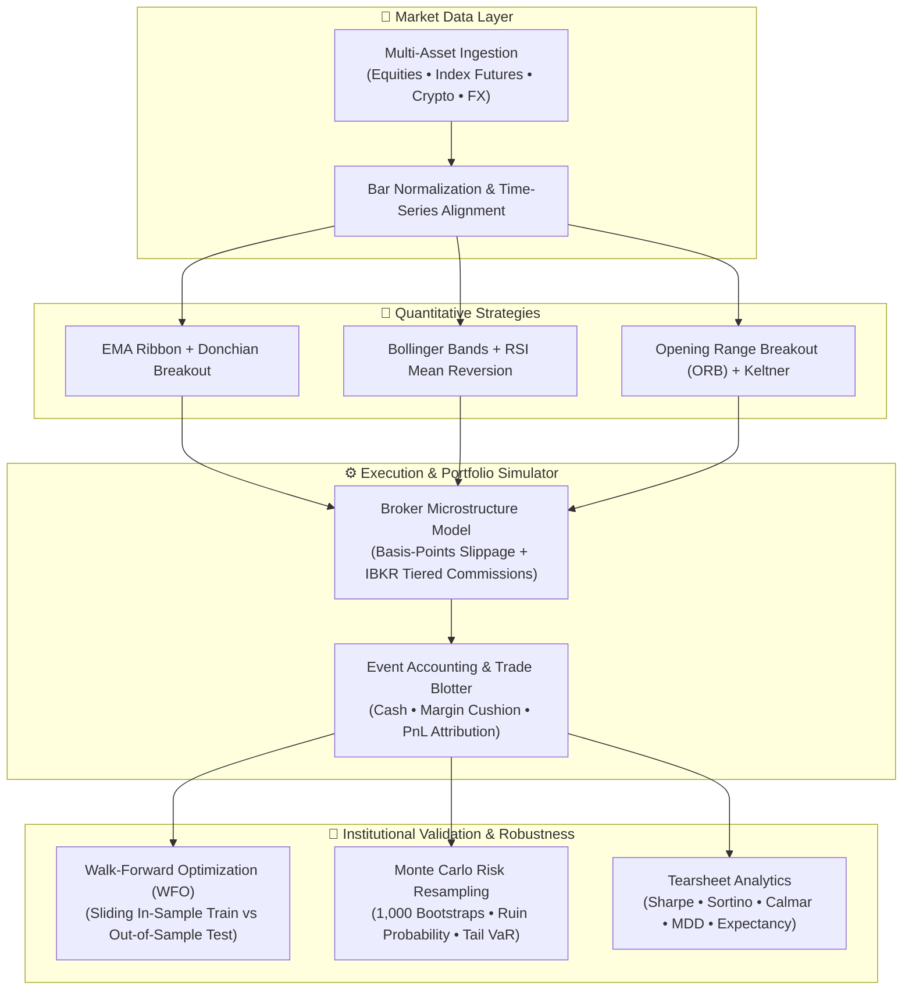

# 🧪 QuantBacktest — Institutional Multi-Asset Backtesting & Research Suite

[](https://python.org)
[](https://numpy.org)
[](https://pandas.pydata.org)
[](https://github.com/jahanzaib-codes/QuantBacktest)
[](https://github.com/jahanzaib-codes/QuantBacktest)
[](https://opensource.org/licenses/MIT)

> An institutional-grade, multi-asset quantitative backtesting and portfolio research framework featuring **Walk-Forward Optimization (WFO)**, **Monte Carlo Risk Resampling (1,000+ bootstraps)**, realistic **broker microstructure frictions (slippage, commissions, margin drag)**, and comprehensive **tewarsheet risk analytics** (Sharpe, Sortino, Calmar, Value-at-Risk VaR, and Maximum Drawdown).

---

### 💼 Need Custom Quantitative Systems, Trading Strategies, or Backtesters?
I develop production-grade algorithmic backtesting platforms, high-frequency execution engines, and risk models for quant funds, prop desks, and private syndicates.
* 💬 **Telegram:** [@JanzebBlockdev](https://t.me/JanzebBlockdev)
* 💼 **Fiverr Profile:** [Verified Quantitative Developer (Fiverr)](https://tinyurl.com/2wruxnsx)
* 📧 **Email:** `jahanzaibchanna70@gmail.com`

---

## 🏗️ System Architecture



---

## ⚡ Key Capabilities

1. **🔬 Walk-Forward Optimization (WFO) & Efficiency (WFE)**
   * Avoids the deadly trap of curve-fitting by dividing backtest history into sliding **In-Sample (Train)** and **Out-of-Sample (Test)** windows. Calculates the **Walk-Forward Efficiency (WFE %)** ratio to mathematically prove strategy durability.

2. **🎲 Monte Carlo Risk & Ruin Simulation (1,000+ Bootstraps)**
   * Resamples real trade sequence distributions across 1,000 to 10,000 iterations to determine 5th-percentile worst-case equity, median drawdown, and the statistical **Probability of Ruin** (chances of encountering a 20%, 30%, or 50% drawdown).

3. **🏛️ Realistic Microstructure & Broker Frictions**
   * Incorporates real-world execution drag:
     * **Slippage Model:** Configurable basis-points (bps) slippage reflecting market depth.
     * **Commissions:** Interactive Brokers tiered equity ($0.005/share) and futures ($0.85/contract) fee structures.
     * **Cash & Margin Accounting:** True portfolio balance, position sizing, and leverage constraints.

4. **📊 Comprehensive Hedge-Fund Tearsheets**
   * Computes risk-adjusted performance metrics:
     * **Risk-Adjusted Return:** Annualized Sharpe Ratio ($R_f$ adjusted), Sortino Ratio (downside volatility only), and Calmar Ratio.
     * **Tail Risk:** Value-at-Risk (Daily VaR 95%) and Conditional VaR (CVaR / Expected Shortfall).
     * **Trade Efficiency:** Win Rate %, Profit Factor, Payoff Ratio, Average Win/Loss, and Mathematical Expectancy.

5. **🏆 Cross-Strategy Portfolio Leaderboard**
   * Benchmark multiple quantitative models side-by-side on the same asset class and historical regime.

---

## 🖥️ Terminal Quantitative Tearsheet Preview

```
================================================================================
                    QUANTITATIVE RESEARCH TEARSHEET
Strategy: EMA_Donchian_Trend             Benchmark: SPY
================================================================================
PORTFOLIO CAPITAL & RETURNS                RISK & VOLATILITY ANALYTICS
---------------------------------------    -------------------------------------
Initial Capital:        $100,000.00        Annualized Volatility:      14.20%
Final Equity:           $134,820.50        Maximum Drawdown (MDD):      7.10%
Total Net Return:             34.82%       Daily VaR (95% Conf):        1.25%
CAGR (Annualized):            15.40%       Daily CVaR / Shortfall:      1.82%
Sharpe Ratio (Rf=4.5%):        1.48        Calmar Ratio:                2.17
Sortino Ratio:                 2.15

TRADE EXECUTION & MICROSTRUCTURE
--------------------------------------------------------------------------------
Total Completed Trades:  28          Win Rate (%):           64.29%
Profit Factor:           2.24        Payoff Ratio (Win/Loss): 1.82
Trade Expectancy:       $1,243.59    Avg Duration:           14.2 bars
================================================================================
```

---

## 🚀 Quickstart

### 1. Installation

```bash
git clone https://github.com/jahanzaib-codes/QuantBacktest.git
cd QuantBacktest
python -m venv .venv

# Windows
.venv\Scripts\activate
# Linux / macOS
source .venv/bin/activate

pip install -r requirements.txt
```

### 2. Environment Configuration

Copy example settings:
```bash
cp .env.example .env
```

Edit `.env` (optional defaults are already pre-configured):
```ini
INITIAL_CAPITAL=100000.0
ACCOUNT_CURRENCY=USD
DEFAULT_COMMISSION_PER_SHARE=0.005
SLIPPAGE_BPS=3.0
DEFAULT_MONTE_CARLO_RUNS=1000
```

### 3. Run Strategy Backtest & Robustness Suite

```bash
# Run Trend-Following Strategy with Monte Carlo & Walk-Forward Optimization
python cli.py --strategy trend --symbol SPY

# Run Mean Reversion Strategy
python cli.py --strategy mean_reversion --symbol AAPL

# Compare Multiple Strategies on Leaderboard
python cli.py --strategy compare --symbol SPY
```

---

## 🧰 Strategy Implementation Protocol

Custom strategies inherit from `BaseStrategy` and implement `generate_signals`:

```python
from src.strategies.base import BaseStrategy
import pandas as pd
import numpy as np

class CustomBreakout(BaseStrategy):
    def __init__(self, period: int = 20):
        super().__init__("Custom_Breakout", {"period": period})
        self.period = period

    def generate_signals(self, df: pd.DataFrame) -> pd.DataFrame:
        data = df.copy()
        high_roll = data["high"].rolling(self.period).max().shift(1)
        data["signal"] = np.where(data["close"] > high_roll, 1, 0)
        data["position_size"] = np.where(data["signal"] == 1, 0.95, 0.0)
        return data
```

---

## 📄 License

Distributed under the **MIT License**. See `LICENSE` for details.

---

### 🌟 Maintained by **Jahanzaib**
* **GitHub:** [@jahanzaib-codes](https://github.com/jahanzaib-codes)
* **Fiverr:** [Hire for Quant & Trading Bot Development](https://tinyurl.com/2wruxnsx)
* **Telegram:** [@JanzebBlockdev](https://t.me/JanzebBlockdev)
* **Email:** `jahanzaibchanna70@gmail.com`

